# Руководство пользователя
здесь представлены 8 самых разных задачь

Задачи:
0. главный экран - тут указаны задачи

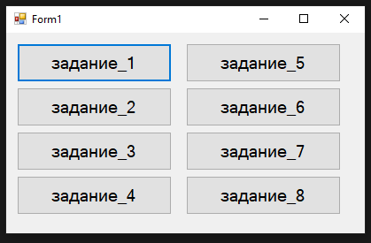

1. задача_1 - игра на угадай число от 1 до 100

- начальный экран

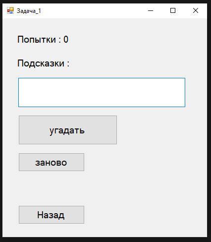

- попытки подсказки

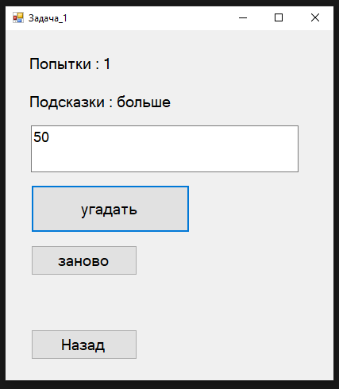

- выйгрыш

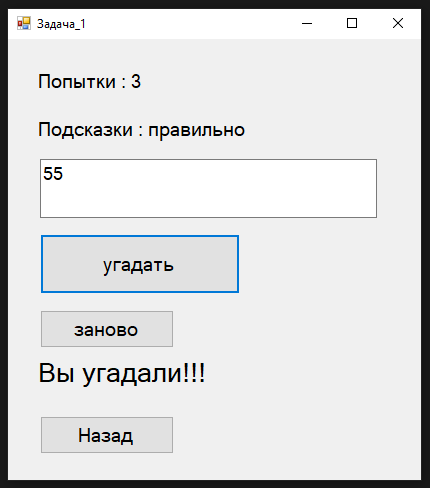

- начать заново или назад на главную

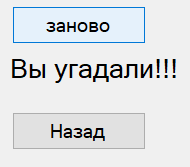

2. задача_2 - нажав на кнопку будут разные цвета

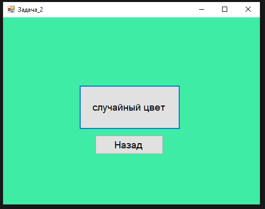

3. задача_3 - выводит окно того чего вы написали

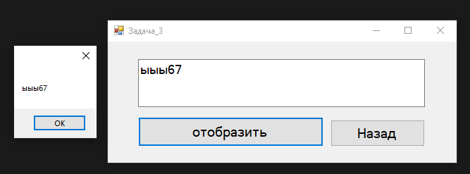

4. задача_4 - нажав на кнопку выведет тот текст что написан на кнопке

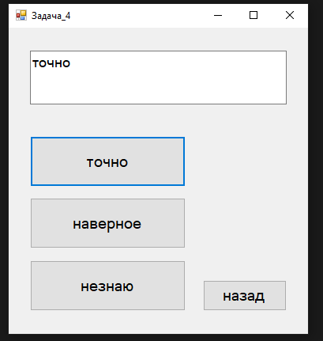

5. задача_5 - нажав на все кнопки появится котик

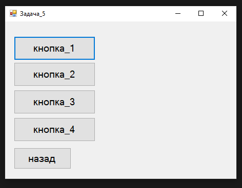

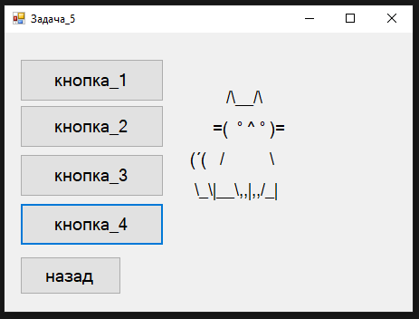

6.  задача_6 - можно вводит текст блокировать ввод и разблокировать

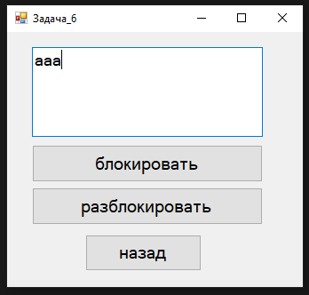

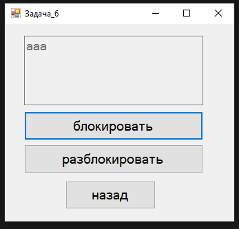

7.  задача_7 - можно сохранить текст и выгрузить

- сохранить

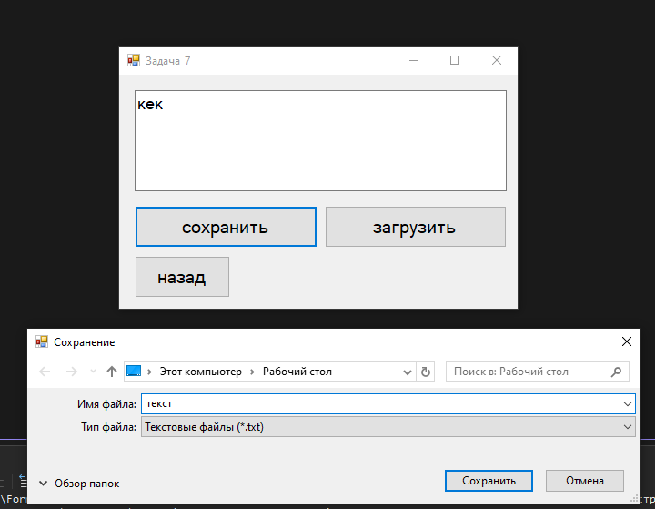

- выгрузить

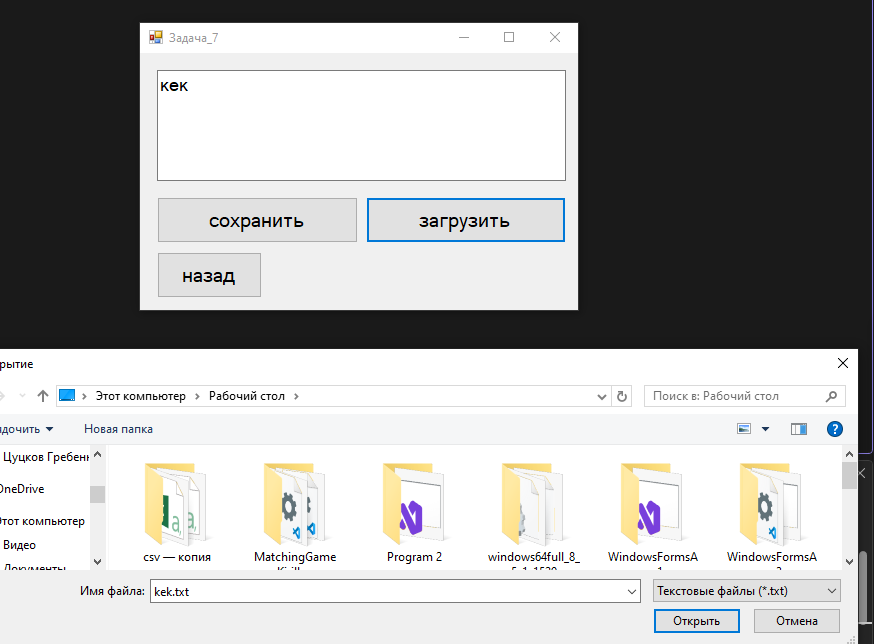

8.  задача_8 - калькулятор простых чисел

- начальный экран

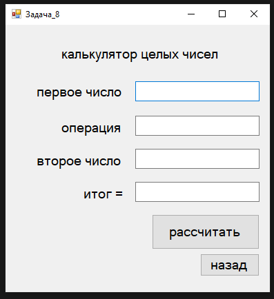

- готовый результат

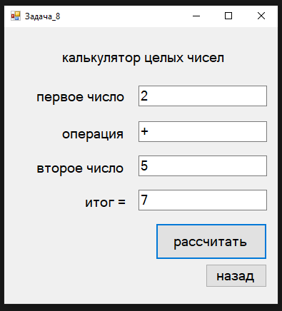

- ошибка при неправильном вводе

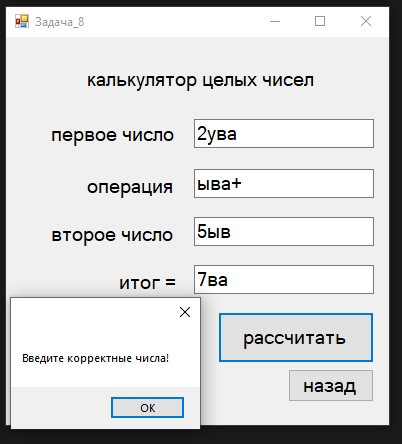
